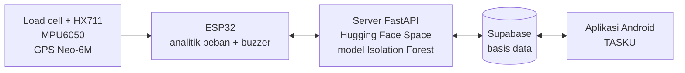

# Personal Adaptive Backpack (TASKU)

Prototipe tas ransel pintar berbasis **IoT dan Machine Learning** yang memantau berat beban, mendeteksi gerakan mencurigakan (indikasi pencurian), dan melacak lokasi tas secara *real-time*.

Proyek mata kuliah **Manajemen Proyek Teknik Informatika**, Program Studi Teknik Informatika, UIN Maulana Malik Ibrahim Malang (2026). Dikerjakan oleh Kelompok 4 selama 12 minggu dengan pembimbing Bpk. Fachrul Kurniawan, S.T., M.T., IPU.

---

## Latar Belakang

Tas ransel dipakai setiap hari untuk membawa laptop, buku, dan barang pribadi. Ada dua masalah yang sering muncul:

1. **Beban terlalu berat** dan dibawa terlalu lama, sehingga berisiko menimbulkan nyeri punggung dan bahu. Pengguna tidak tahu berat tasnya sebelum keluhan muncul.
2. **Tas rawan dicuri** di ruang publik, dan pemiliknya baru sadar setelah tas dibawa jauh.

Kedua masalah ini berakar dari hal yang sama: tidak ada sistem yang memantau kondisi tas secara *real-time*.

## Fitur Utama

| Fitur | Cara kerja |
|---|---|
| Pemantauan beban | Load cell + HX711 membaca berat tas. Batas aman dihitung dari 10% berat badan pengguna yang diatur lewat aplikasi. |
| Analitik beban | Penyaringan lonjakan sesaat, rata-rata 10 bacaan terakhir, dan status **aman / hampir batas / berlebih**. Status berlebih hanya muncul jika beban bertahan di atas batas ≥ 10 detik. |
| Peringatan | Buzzer berbunyi saat beban berlebih atau saat model ML mendeteksi gerakan mencurigakan dalam mode anti-maling. |
| Deteksi anomali gerakan | Data IMU (MPU6050) dikirim ke server dan diklasifikasikan oleh model **Isolation Forest** sebagai gerakan normal atau mencurigakan. |
| Pelacakan lokasi | Koordinat GPS Neo-6M ditampilkan di peta pada aplikasi Android. |

## Arsitektur Sistem

Data mengalir dua arah:
- **Alat → aplikasi:** berat, lokasi, dan kejadian beban berlebih.
- **Aplikasi → alat:** profil berat badan dan mode anti-maling.

## Model Machine Learning

| Aspek | Keterangan |
|---|---|
| Algoritma | Isolation Forest (scikit-learn), deteksi anomali *unsupervised* |
| Input | Jendela 2 detik (40 sampel pada 20 Hz) percepatan dan giroskop 3 sumbu, ditambah berat tas |
| Fitur | 15 fitur statistik: rata-rata, simpangan baku, dan maksimum besaran percepatan/giroskop; simpangan baku tiap sumbu; rata-rata, simpangan baku, dan rentang berat |
| Data | 1.569 jendela gerakan normal (diam, berjalan, diletakkan) dan 589 jendela mencurigakan (diangkat tiba-tiba, diguncang, ditarik paksa) |
| Pembagian | Latih 1.097 · validasi 513 (penentuan *threshold*) · uji 548 |

**Hasil pada data uji (data sintetis):**

| Metrik | Nilai |
|---|---|
| Akurasi | 99,3% (544 dari 548 jendela) |
| Precision (mencurigakan) | 0,994 |
| Recall (mencurigakan) | 0,994 |
| F1-score | 0,994 |
| ROC-AUC | 1,000 |

> **Catatan:** model dilatih dengan **data sintetis** yang disusun dari pola fisika gerakan (gravitasi, derau sensor, ayunan langkah 1,5–2,3 Hz, guncangan 4–8 Hz), karena rekaman data asli baru bisa diambil setelah server stabil. Angka di atas adalah batas atas kinerja; evaluasi ulang dengan data rekaman alat menjadi tindak lanjut proyek.

## Hasil Pengujian Integrasi

Delapan skenario integrasi diuji pada 15–24 November 2026, dan **semuanya berhasil**, antara lain:
- Data alat tersimpan di Supabase dengan berat yang sama dengan pembacaan alat.
- Beban saat ini, rata-rata, beban tertinggi, dan grafik tren tampil di aplikasi.
- Lokasi GPS tas tampil di peta beserta posisi HP dan rutenya.
- Perubahan berat badan di aplikasi (41 → 30 kg) langsung mengubah batas aman di alat (4,1 → 3,0 kg).
- Keputusan model ML di server menyalakan sirene buzzer saat mode anti-maling aktif.

## Manajemen Proyek

Proyek dijalankan dengan siklus manajemen proyek lengkap:
- **Inisiasi:** project charter, identifikasi stakeholder, studi kelayakan TELOS.
- **Perencanaan:** Work Breakdown Structure (6 kategori, 16 paket kerja), jadwal 12 minggu (Gantt chart, ProjectLibre), rencana anggaran, dan risk register.
- **Monitoring:** rapat dan notulen mingguan (M1–M10), log evaluasi dan perbaikan (*debugging*).
- **Pengujian:** uji unit tiap sensor, kalibrasi load cell, dan uji integrasi sistem penuh.

## Tim dan Peran

| Nama | Peran |
|---|---|
| **Zidnia Ilma Arifa** | Ketua tim / Project Manager: perencanaan proyek (charter, WBS, jadwal, anggaran, risiko), koordinasi dan monitoring mingguan, pelaksana pengujian, dan dokumentasi |
| Geraldy Putra Fazrian | Software, backend, dan machine learning |
| Naufal Mubarok | Hardware (perakitan sensor dan mikrokontroler) |

## Teknologi

`ESP32` · `Load cell + HX711` · `MPU6050` · `GPS Neo-6M` · `Buzzer` · `Python` · `scikit-learn` · `FastAPI` · `Hugging Face Spaces` · `Supabase` · `Android` · `Google Colab` · `ProjectLibre`

---

*Repositori ini berisi dokumentasi proyek. Kode aplikasi, server, dan model dikembangkan oleh anggota tim sesuai pembagian peran di atas.*
